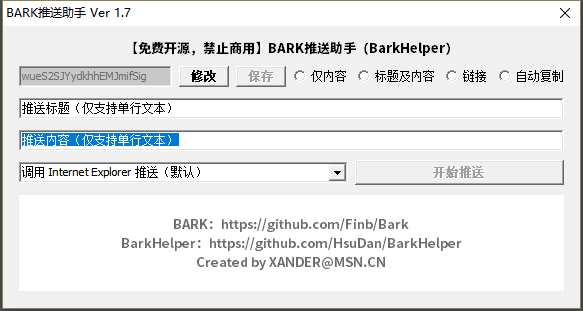

# BarkHelper
BarkHelper is a Windows desktop companion for the open-source project Bark. It saves you the hassle of repeatedly copying, pasting and editing push URLs by hand. 
A note from the author: I haven't been a programmer for a long time. I wrote some non-commercial software in Delphi over a decade ago, and many years later my skills have mostly faded, so please forgive any clumsy code.
> What is Bark? 
> Bark is an iOS App which allows you to push customed notifications to your iPhone  
> Client <https://github.com/Finb/Bark>  
> Server <https://github.com/Finb/go-tools>  
> AppStore <https://itunes.apple.com/cn/app/bark-customed-notifications/id1403753865>  
## Notes
1. 360 Total Security may occasionally flag the program as a false positive. Because the program needs to launch a web browser, it uses the ShellAPI unit (line 7) and calls ShellExecute() (line 193). 360 may treat this as a threat to system security, but rest assured, my skills are nowhere near good enough to write a trojan or virus [facepalm]. 
2. In my own testing, pushed links must be complete URLs (including the http:// or https:// prefix), otherwise tapping the notification won't open them. This may be a limitation of the Bark app itself, but I'm not certain. If you know more, I'd appreciate any comments or suggestions. Thanks! 
## Release Notes
Ver 1.7 
1. Added support for Chrome and Firefox (thanks to JuvenRui, rgxgr, Ringoxue and cw for their feedback and suggestions), and changed browser selection to a combobox drop-down; 
2. Enlarged the visible area of the text box (thanks to cwup for the feedback and suggestion) to make editing after pasting easier; rearranged the other controls accordingly so the program is more intuitive to use; 
3. Fixed bugs in the "Link" and "Auto Copy" features (thanks to cw for the feedback and suggestion); 
4. Improved the default placeholder text shown in the text box for each RadioBtn option; 
5. Added SetFocus to the text box controls; fixed the enabled state of the Edit Key and Save buttons; 
6. Added a program icon; 
7. Tidied up and optimized some code.  
 
 
 
Ver 1.6 
Some code adjustments, UI adjustments, etc.
 
 
Ver 1.5 
Added saving the Key configuration to an INI file
 
 
Ver 1.4 
Added the ability to launch 360 Speed Browser directly; the Push button is disabled until a RadioBtn is selected; the "Title" Edit control is disabled when any RadioBtn other than "Title and Content" is selected
 
 
Ver 1.3 
Added 4 RadioBtns: "Content Only", "Title and Content", "Link" and "Auto Copy"
 
 
Ver 1.2 
Added the ability to open the push URL directly in the system default browser, so you can push with one click once the content is filled in
 
 
Ver 1.1 
Added 3 Edit controls: "Title", "Link" and "Push Text"
 
 
Ver 1.0 
Initial idea: replace the repetitive copy/paste/edit routine with a program; tried out "Content Only" pushes
